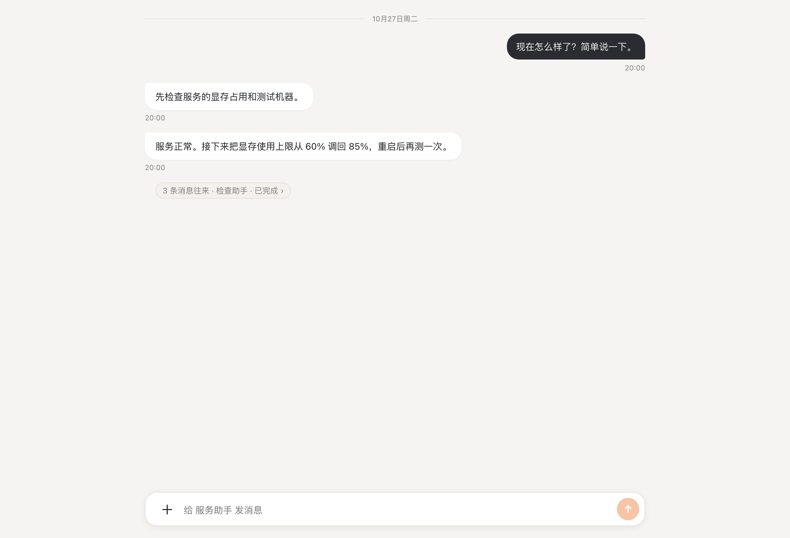
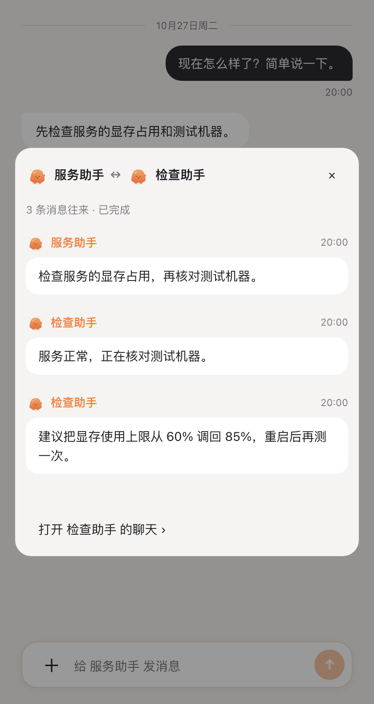

# 回复与传话详情预览

截图来自 `desktop/tests/chat.harness.tsx` 的固定测试数据，不连接真实账号。

| 宽屏分段回复 | 窄屏传话详情 |
| --- | --- |
|  |  |

`desktop/tests/chat-ui.test.ts` 覆盖首条回复先显示、最终结果去重、详情加载失败重试、分页、关闭以及窄屏不溢出。设置 `CHAT_UI_SCREENSHOTS` 可在测试结束后保存截图。
